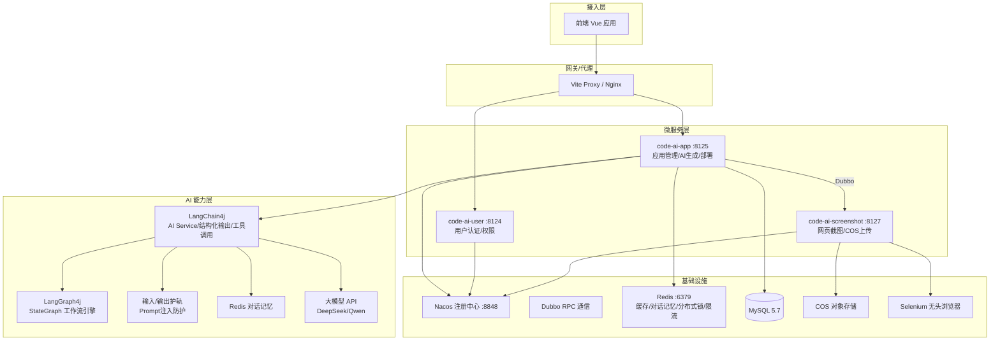

# code-ai-generate - 后端

gzy前端项目秒搭平台后端服务，基于 Spring Boot 3 + LangChain4j 构建的 AI 代码生成微服务系统。支持通过自然语言生成前端应用代码，并提供构建、部署、截图全链路能力。

## 项目架构图



## 功能模块

### 核心服务

| 服务 | 端口 | 职责 |
|------|------|------|
| code-ai-app | 8125 | 应用管理、AI 代码生成、构建部署、静态资源服务、SSE 流式对话 |
| code-ai-user | 8124 | 用户注册/登录、权限校验、会话管理 |
| code-ai-screenshot | 8127 | 网页截图、COS 文件上传 |

### 业务模块

| 模块 | 说明 |
|------|------|
| 🤖 AI 代码生成 | 基于 LangChain4j AI Service，支持 HTML/多文件/Vue 三种模式，结构化输出 + 工具调用 |
| 🧭 智能路由 | AI 根据用户需求自动选择代码生成模式 |
| 📊 LangGraph4j 工作流 | Prompt 增强 → 代码生成 → 质量检查 → 构建 → 部署 多节点编排 |
| 💬 对话记忆 | Redis 持久化多轮对话上下文，支持分布式会话 |
| 🚀 一键部署 | 构建 Vue 项目并发布到静态服务器，生成访问 URL |
| 📸 自动截图 | Selenium 无头浏览器截取生成页面，上传 COS 作为封面 |
| 🛡️ AI 安全护轨 | 输入护轨防 Prompt 注入，输出护轨校验格式 + 自动重试 |
| ⚡ 分布式限流 | Redisson + 自定义注解 + AOP 保护核心接口 |
| 💾 多级缓存 | Caffeine 本地缓存 + Redis 分布式缓存 |

## 技术选型

### AI 框架
- **LangChain4j 1.1** - AI Service、结构化输出、工具调用、对话记忆、输入/输出护轨
- **LangGraph4j** - StateGraph 状态图、条件边、并发分支工作流编排

### 微服务
- **Spring Boot 3.5** - 基础框架
- **Java 21** - 虚拟线程
- **Dubbo 3.3** - RPC 通信
- **Spring Cloud Alibaba / Nacos** - 服务注册发现

### 数据与缓存
- **MyBatis Flex** - ORM 框架，LambdaQueryWrapper
- **MySQL 5.7** - 关系型数据库
- **Redis** - 缓存、对话记忆、分布式锁、限流
- **Caffeine** - 本地缓存
- **Redisson** - 分布式锁与限流

### 响应式与并发
- **Reactor** - 响应式编程，SSE 流式响应
- **CompletableFuture + 自定义线程池** - 并发加速 I/O 密集任务
- **Spring Bean prototype 作用域** - 解决有状态 AI Bean 并发问题

### 工具与中间件
- **Hutool** - 工具类库
- **Lombok** - 简化代码
- **Knife4j** - API 文档
- **Selenium + WebDriverManager** - 无头浏览器截图
- **COS SDK** - 对象存储

### 工程实践
- **设计模式** - 门面、策略、模板方法、工厂、执行器模式
- **Spring AOP** - 权限拦截、限流切面
- **全局异常处理** - 统一异常响应

## 项目结构

```
code-ai-generate/
├── code-ai-ai/            # AI 能力模块（LangChain4j/LangGraph4j）
│   ├── guardrail/         # 输入/输出护轨
│   ├── model/             # 结构化输出模型
│   ├── tools/             # AI 工具（文件读写/删除）
│   └── AiCodeGeneratorService.java
├── code-ai-app/           # 应用服务（主服务）
│   ├── controller/        # REST 接口
│   ├── langgraph4j/       # 工作流节点与状态
│   ├── core/              # 代码解析/保存/构建
│   ├── service/           # 业务服务
│   └── ratelimit/         # 分布式限流
├── code-ai-user/          # 用户服务
├── code-ai-screenshot/    # 截图服务
├── code-ai-common/        # 公共模块
├── code-ai-model/         # 实体与枚举
├── code-ai-client/        # Dubbo 接口定义
└── sql/                   # 数据库脚本
```

## 快速开始

### 环境要求
- JDK 21
- Maven 3.8+
- MySQL 5.7+
- Redis 6+
- Nacos 2.x

### 启动顺序
1. 启动 Nacos (8848)
2. 启动 Redis (6379)
3. 启动 code-ai-user
4. 启动 code-ai-screenshot
5. 启动 code-ai-app

### 数据库初始化
```sh
mysql -uroot -p < sql/create_table.sql
```

## 前端项目

前端仓库：[guo-zhiyong-zero-code-platform](../guo-zhiyong-zero-code-platform)

## 许可证

MIT